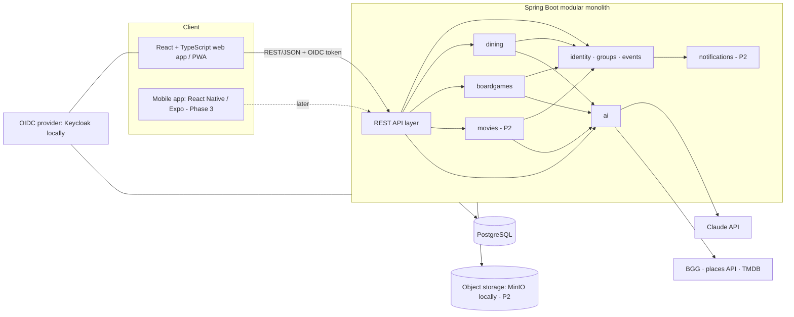

# CrewUp — Architecture

**Status:** Draft v0.1 · October 6, 2026 · Companion to `requirements.md`

> Version numbers below are targets. Confirm the current stable releases when you scaffold the project (Milestone 0).

## 1. System overview



## 2. Technology choices

| Layer | Choice | Why |
|---|---|---|
| Language and runtime | Java 25 (LTS) | Builds on your strongest skill |
| Framework | Spring Boot (current 4.x) | Same reason, plus it's widely expected in job postings |
| Module boundaries | **Spring Modulith** | Enforced module boundaries, verified in tests, with event publication between modules |
| Persistence | PostgreSQL · Spring Data JPA · Flyway | Arrays and JSONB where useful; full-text search for the timeline |
| API docs | springdoc-openapi, with a generated TypeScript client | One contract shared by backend and frontend |
| Auth | Spring Security OAuth2 Resource Server + OIDC (Keycloak in Docker for development) | Standard and provider-agnostic. Pick a hosted provider at deploy time (ADR-004). |
| AI | **Spring AI** with the Anthropic (Claude) model, tool calling, and structured output | Spring-native, and it fits your Java background |
| Frontend | React · TypeScript · Vite · React Router · TanStack Query · Tailwind CSS + shadcn/ui · React Hook Form + Zod · Recharts | The mainstream, in-demand React stack |
| Testing | JUnit 5 · Testcontainers · Modulith tests · Vitest + React Testing Library · Playwright (end-to-end) · MSW (API mocks) | |
| Local environment | Docker Compose (Postgres, Keycloak, MinIO) | One command to run everything |
| CI | GitHub Actions: build, test, lint, Modulith verification, Playwright smoke test | |
| Hosting | TBD (ADR-005): for example Fly.io, Render, or AWS (App Runner + RDS) | A live demo link matters for your resume |

## 3. Repository layout (monorepo)

```
crewup/
├── CLAUDE.md
├── docs/            requirements.md · architecture.md · roadmap.md · approach.md
│   ├── adr/         numbered architecture decision records
│   └── specs/<feature>/  spec.md · plan.md · tasks.md
├── backend/         Spring Boot application (Gradle or Maven)
│   └── src/main/java/app/crewup/
│       ├── identity/      users, OIDC mapping
│       ├── groups/        groups, members, roles, invitations
│       ├── events/        events, activities, attendees, the Activity Type SPI
│       ├── timeline/      search and history read models
│       ├── dining/        Activity Type module
│       ├── boardgames/    Activity Type module
│       ├── movies/        Activity Type module (P2)
│       ├── ai/            LLM client, tools, budget, caching
│       ├── notifications/ (P2)
│       └── shared/        cross-cutting types only (ids, money, time)
├── frontend/        React app
│   └── src/
│       ├── app/           shell, routing, auth
│       ├── core/          groups, members, events, timeline
│       ├── activity-types/
│       │   ├── registry.ts
│       │   ├── dining/
│       │   └── boardgames/
│       └── shared/        UI kit, generated API client
├── docker-compose.yml
└── .github/workflows/
```

## 4. The Activity Type plug-in contract

This contract delivers the goal "add an Activity Type without changing other Activity Types." Core (`events`) owns Event, Activity, attendees, and the log. Each Activity Type module owns its details and catalog.

### Backend SPI (in the `events` module's public API)

```java
public interface ActivityTypeProvider {
    String typeCode();                    // "DINING", "BOARD_GAMING"
    ActivityTypeDescriptor descriptor();  // display name, icon key, sort order
    void onActivityCopied(UUID sourceActivityId, UUID newActivityId); // copy-event support (EVT-5)
    void onActivityDeleted(UUID activityId);
    ActivitySummary summarize(UUID activityId); // one-line summary for the timeline
}
```

Rules:

- `events` discovers providers as Spring beans. It never imports an Activity Type module.
- Activity Type modules depend on `events` and `groups` public APIs only, **never on each other**. Spring Modulith's `verify()` test enforces this in CI.
- A module exposes its own REST endpoints under `/api/groups/{groupId}/activities/{activityId}/<type>/…` and its catalog under `/api/groups/{groupId}/<type>/…`.
- Cross-module reactions use application events (for example, `ActivityCopied` or `MemberDeactivated`) through Spring Modulith's event publication registry.
- Each module owns its own tables (prefixed `dining_`, `bg_`, `mov_`) and its own Flyway migrations folder.

### Frontend registry

```ts
export interface ActivityTypePlugin {
  code: 'DINING' | 'BOARD_GAMING' | string;
  label: string;
  icon: IconComponent;
  DetailEditor: React.FC<{ activityId: string; groupId: string }>;
  DetailView: React.FC<{ activityId: string; groupId: string }>;
  routes?: RouteObject[];           // catalog pages, such as /restaurants
  summarize?: (a: ActivityDto) => string;
}
// activity-types/registry.ts imports each plugin. Adding a type = new folder + one line here.
```

The UI is split into **Event planning** (core: Event list and create/edit flow, attendee picker, timeline) and **Activity Type areas** (each plugin's editors, views, and catalog pages), as the original document requested.

### Path to microservices (later, if justified)

Because modules already communicate through a published API and events, a module can be extracted into its own service. Its REST endpoints move behind a gateway, its in-process events become messages (for example, through Kafka or RabbitMQ), and its tables move to their own database. Document the trigger for doing this (independent scaling, a separate team, or separate release cadence) in an ADR rather than doing it upfront.

## 5. API design

- REST/JSON. Every group resource sits under `/api/groups/{groupId}/…`, so authorization always has the group in scope.
- Examples:
  - `POST /api/groups/{g}/events` · `POST /api/groups/{g}/events/{e}/copy` with `{ startsAt }`
  - `GET /api/groups/{g}/timeline?type=DINING&member=…&from=…&q=…`
  - `GET /api/groups/{g}/members?sort=FREQUENT|ALPHA`
  - `POST /api/groups/{g}/invitations` returns a link and QR payload · `POST /api/invitations/{token}/accept`
  - `POST /api/groups/{g}/boardgames/lookup` with `{ query }` returns candidates (AI-1)
- Errors follow RFC 9457 Problem Details. Lists use cursor pagination. Concurrent edits use optimistic locking (`ETag`/`If-Match`).

## 6. Security and authorization

- JWT access tokens from the OIDC provider. The backend maps `sub` to a User.
- A `GroupAccessEvaluator` resolves the caller's Member and role for `{groupId}` once per request. Method security (`@PreAuthorize("@groupAccess.can(#groupId, 'EVENT_EDIT')")`) checks permissions from the ROL-2 matrix.
- "Own only" rules compare `created_by` to the caller's Member.
- Invitation tokens are random 256-bit values, stored hashed, single use, and expiring.
- Tests: every endpoint has an authorization test per role, generated from the permission matrix.

## 7. AI design

- **Spring AI ChatClient** with Claude. Use a small, fast model for lookups and a stronger one only where reasoning matters.
- **Tool calling, not free text:** For AI-1, the model receives tools `bgg_search(query)` and `bgg_get(id)`, and returns a typed `BoardGameCandidate[]` (structured output). The user picks, then the backend fetches authoritative fields from BGG directly. The model chooses and summarizes; the source API supplies the facts.
- **Recommendations (AI-3, AI-7) are hybrid:** A deterministic, unit-tested scoring function ranks candidates (dietary match, cuisine sentiment, group rating, visited recently, open at the planned time). The LLM receives the ranked list and writes the explanations. This is testable, cheap, and explainable, which makes a strong portfolio talking point.
- **Guardrails:** prompt templates in versioned resources, timeouts, retries with backoff, response caching (for example, BGG data by ID for 30 days), a per-group monthly token budget (NFR-10), and no personal data sent beyond what a feature needs (first names and preferences only, for AI-3).
- **Evals:** A small fixed set of lookup queries with expected results runs in CI against recorded responses, and against the live API manually.
- **Cost:** API usage is billed to an Anthropic Console account and is **separate from your Pro subscription**. Set a monthly spend limit there.

## 8. Data and persistence

- PostgreSQL. Tables are owned by modules, with migrations per module.
- UUID v7 primary keys. `timestamptz` for instants, with the IANA zone stored on Event.
- Timeline search uses Postgres full-text search (a `tsvector` over the Event name, logs, notes, and dish names). This is enough for the MVP; no separate search engine needed.
- Soft delete via `deleted_at`, with a nightly purge job after 30 days.

## 9. Testing strategy

| Level | Tooling | What it covers |
|---|---|---|
| Unit | JUnit 5, Vitest | Domain rules: copy-event offsets, scoring, placement ties, permissions |
| Module | Spring Modulith `@ApplicationModuleTest`, `verify()` | Module boundaries; each module tested in isolation |
| Integration | Testcontainers (Postgres, Keycloak) | Repositories, migrations, security |
| API contract | OpenAPI spec diff in CI | Prevents breaking the generated frontend client |
| Component | React Testing Library + MSW | Forms, attendee picker, registry plug-ins |
| End to end | Playwright | Golden paths: create group → invite → log dinner → see timeline |

Each acceptance criterion in `requirements.md` maps to a test. Test names reference requirement IDs, such as `EVT5_copyShiftsAllActivityTimes`.

## 10. Architecture decision records (to write in `docs/adr/`)

| ADR | Decision | Status |
|---|---|---|
| 001 | Modular monolith with Spring Modulith instead of microservices per Activity Type | Accepted |
| 002 | React + TypeScript web/PWA first; React Native/Expo for mobile later | Accepted |
| 003 | User/Member split; roles on Member | Proposed |
| 004 | OIDC provider: Keycloak for development; hosted provider TBD | Proposed |
| 005 | Hosting platform | Open |
| 006 | AI: Spring AI + Claude, tool calling, hybrid scoring | Proposed |
| 007 | Per-group catalogs instead of a shared global catalog | Proposed |
| 008 | External data sources: BGG, places API, TMDB, with license review | Open |
